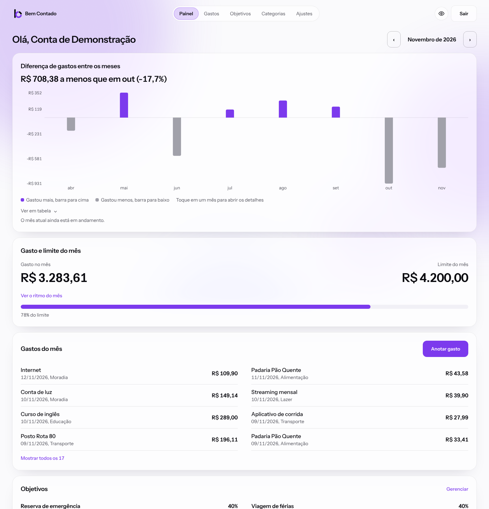
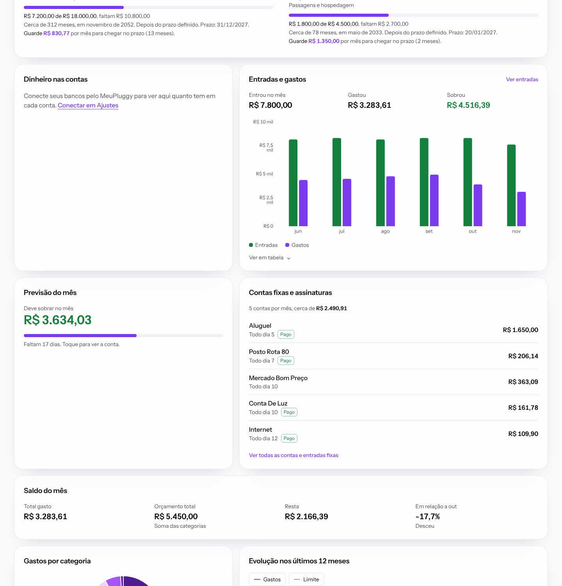
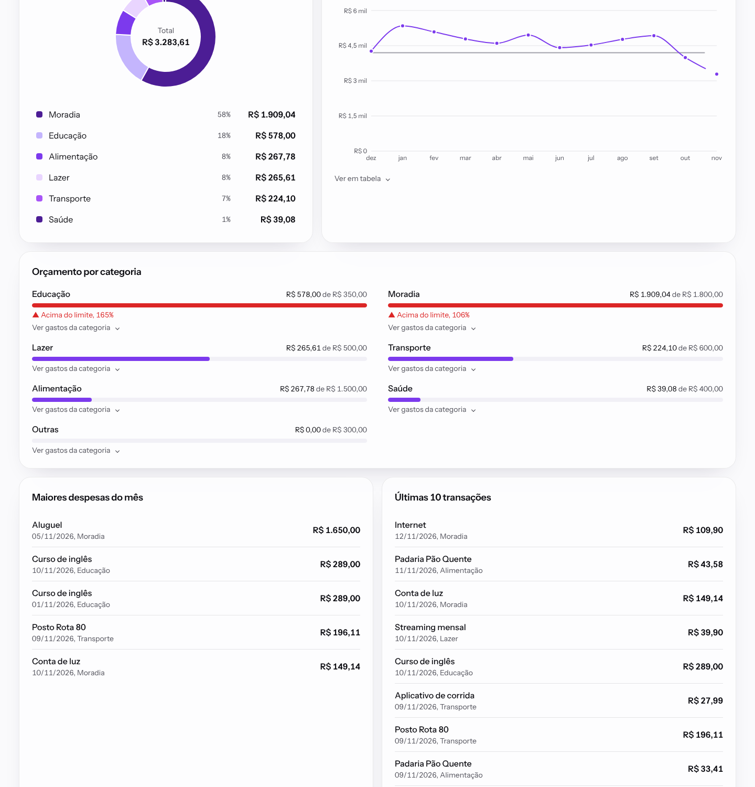
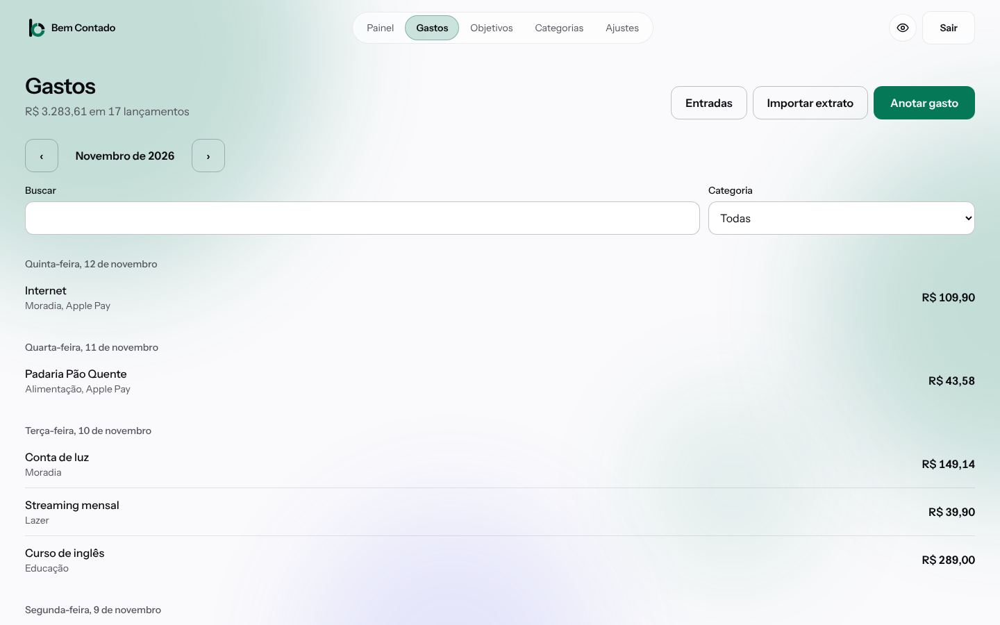
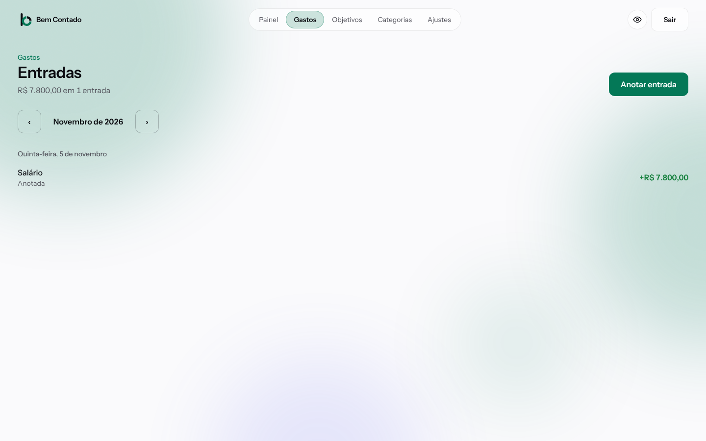
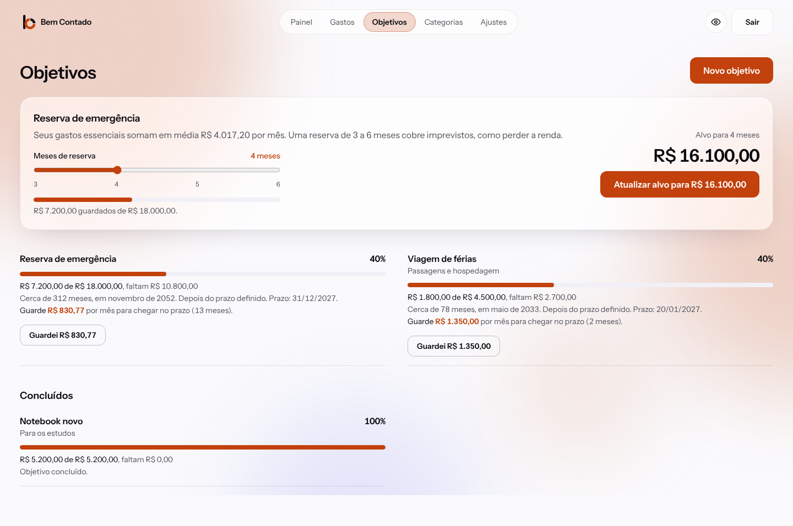
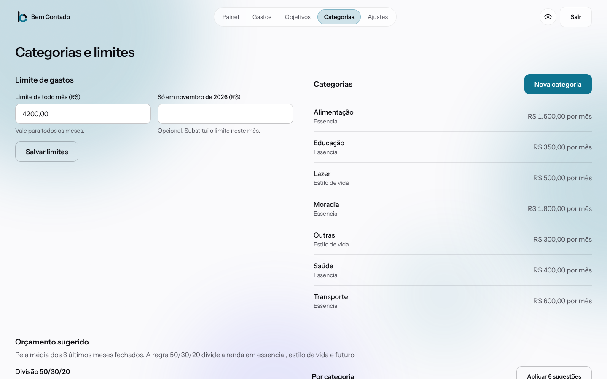
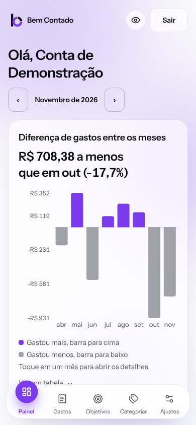
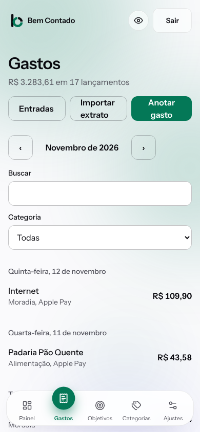
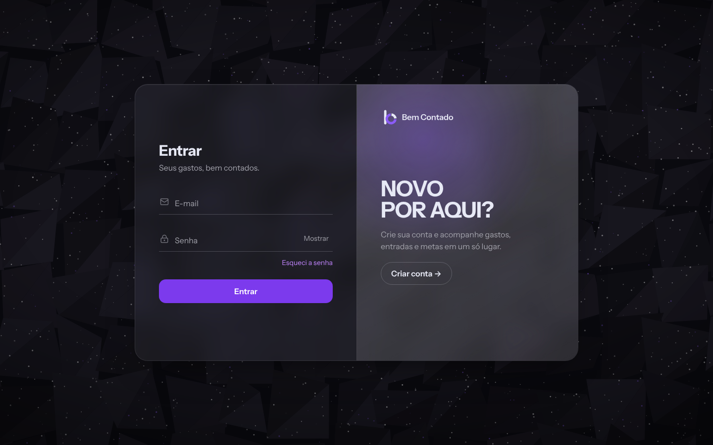

# Bem Contado

Aplicativo de controle de despesas pessoais para iPhone, Android e web (PWA). Cada pessoa tem a própria conta, e ninguém acessa os dados de outra.

> Este repositório é a apresentação pública do projeto. O código-fonte fica em um repositório privado. O projeto está em desenvolvimento e hoje é usado pelo autor e por familiares.

## O que o app faz

- **Lançamento manual** de despesas, com descrição, valor, data e categoria.
- **Captura automática do Apple Pay**: um Atalho do iPhone envia cada compra feita pela Carteira para o app.
- **Acompanhamento por categoria e por mês**, com orçamento mensal opcional e avisos no celular.
- **Orçamento sugerido** (regra 50/30/20 e média por categoria).
- **Objetivos financeiros**, com reserva de emergência e aporte sugerido.
- **Importação de extrato** em OFX ou CSV, com regras que aprendem a categoria de cada estabelecimento.
- **Entradas** (salário, Pix recebido) separadas das despesas.
- **Open Finance** pelo MeuPluggy, com as chaves de cada pessoa.
- **Previsão e contas fixas**, painel com gráficos e tema claro e escuro.

## Telas

Capturas com uma conta de demonstração e dados fictícios.

**Painel**

**Gastos, entradas, objetivos e categorias**

**No celular (PWA)**

**Acesso**

## Privacidade e segurança

- Isolamento por usuário em todas as tabelas, com políticas RLS no PostgreSQL.
- Chaves de serviço nunca vão para o front-end.
- Tokens de captura são guardados só como hash e podem ser revogados.
- Consentimento claro, finalidade registrada e exclusão dos dados pelo próprio usuário (LGPD).
- Testes automatizados das políticas de segurança do banco.

## Tecnologias

React 18 · TypeScript · Vite · Tailwind CSS · TanStack Query · Recharts · Supabase (PostgreSQL, Auth, RLS, Edge Functions) · PWA · Vitest · pgTAP

## Arquitetura

| Camada | Função |
|---|---|
| Web (React + Vite) | Telas, gráficos, importação e PWA para o celular |
| Supabase | Banco, autenticação, RLS e funções de borda |
| Edge Functions | Captura do Apple Pay, Open Finance e avisos no celular |
| Atalhos do iPhone | Envia cada pagamento da Carteira para o app |

## Autor

Perin ([@AwsGames-byte](https://github.com/AwsGames-byte))
